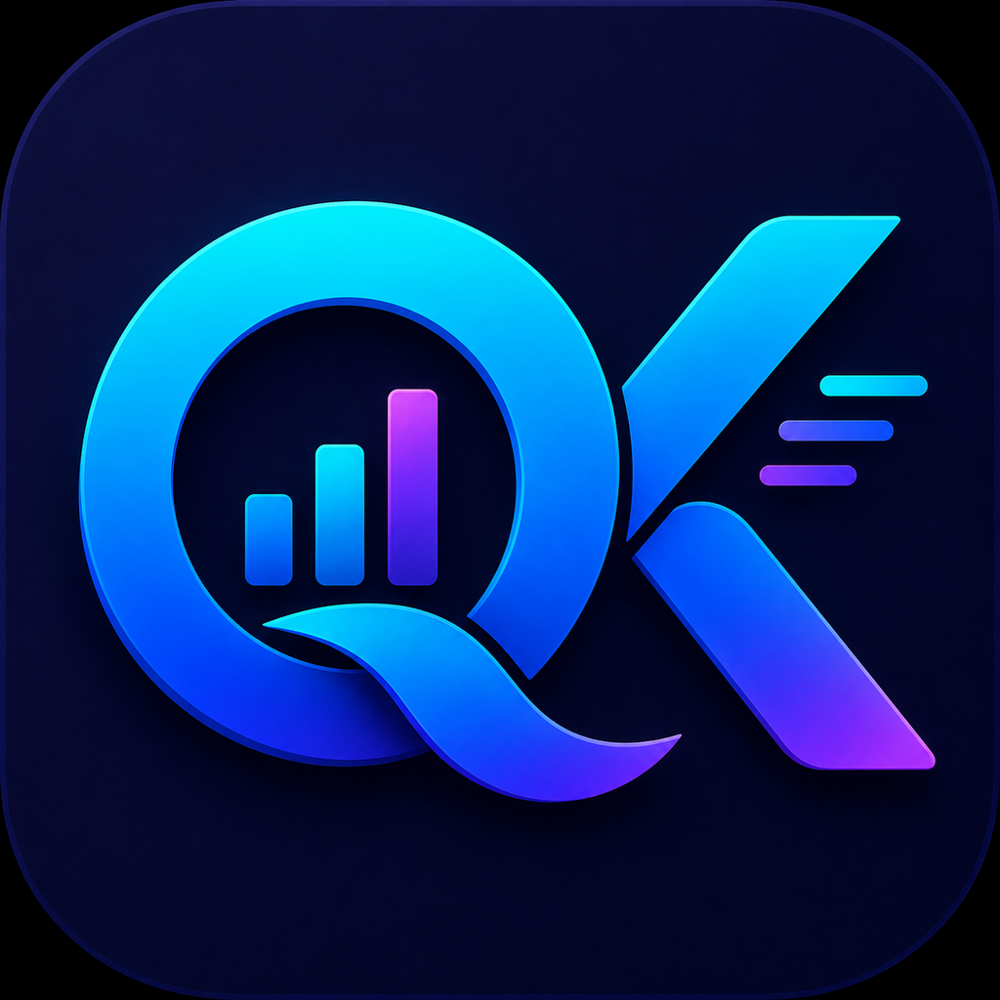
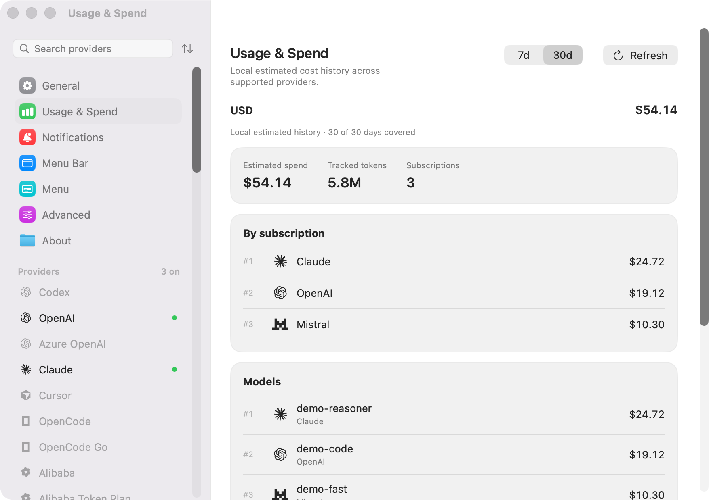

# QuotaKit



Track AI quota, usage, and spend on Mac and iPhone. QuotaKit by Columbus Labs collects data locally on your Mac and syncs it through your iCloud account to the iPhone companion, with status views, alerts, share cards, and widgets.

## Get QuotaKit

- [Mac download and setup](https://columbus-labs.com/quotakit/mac)
- [Latest Mac release](https://github.com/ColumbusLabs/QuotaKit/releases/latest)

Install QuotaKit on your Mac first. After iCloud Sync is enabled on the Mac, the iPhone app can show synced quota data and send quota notifications.

## Highlights

- Quota tracking for Codex, Claude, Cursor, Gemini, Future AGI, Munito, OpenAI, and many more. See the [provider catalog and setup notes](docs/providers.md) for supported sources and requirements.
- iCloud sync from Mac to iPhone, including quota windows, reset timing, provider status, spend, and account metadata.
- iPhone alerts when a provider runs out of quota or becomes available again.
- Cost dashboards with daily spend, model mix, provider share, and renewal-cycle progress.
- A unified Mac usage-and-spend dashboard plus optional external hooks for quota and provider-state events.
- A stacked merged menu icon that shows two providers at once, using each provider’s first layout line.
- QuotaKit Pro widgets for Home Screen and Lock Screen status at a glance.
- Share cards for usage and cost views.

## Preview



Mac Usage & Spend dashboard with demo data. Available quota windows and cost details depend on each provider's data source.

## How It Works

1. Install QuotaKit on your Mac.
2. Enable the providers you use in Mac settings.
3. Turn on iCloud Sync.
4. Open QuotaKit on iPhone with the same iCloud account.

The Mac app does the provider-side work. The iPhone app is a companion that reads synced data, displays it clearly, and sends notifications.

## Privacy

QuotaKit is designed around local collection and private sync. Provider credentials, browser sessions, local logs, and account data are read only for the providers you enable. Synced quota data stays in your iCloud account.

Some providers may require local permissions on macOS, such as access to browser cookies, provider CLI credentials, or Keychain items. Those permissions are used for quota collection and are not a general disk scan.

## Development

This repo contains both the Mac app and the iOS companion app. iOS-specific work lives under `CodexBarMobile/`; shared sync code lives under `Shared/`. Internal targets retain inherited names such as `CodexBar` and `CodexBarCLI`.

Build the Mac app with `swift build`. The package requires Swift 6.2 and macOS 14 or later. The iPhone companion requires iOS 17 or later.

Common checks:

```bash
./Scripts/lint.sh lint

xcodebuild -project CodexBarMobile/CodexBarMobile.xcodeproj \
  -scheme CodexBarMobile \
  -destination 'platform=iOS Simulator,name=iPhone 17 Pro' \
  CODE_SIGNING_ALLOWED=NO test
```

Generate the iOS project after editing `CodexBarMobile/project.yml`:

```bash
cd CodexBarMobile
xcodegen generate
```

## Documentation

- [Provider catalog and setup notes](docs/providers.md) — supported providers, authentication sources, and available quota/cost data.
- [CLI configuration](docs/cli-configuration.md) — configuration, source selection, and overrides.
- [Provider authoring guide](docs/provider.md) — adding a provider.
- [Release guide](docs/RELEASING.md) — packaging and release validation.
- [Privacy policy](https://columbus-labs.com/quotakit/privacy).

## Linux desktop integration

QuotaKit distributes the portable Linux CLI. Desktop panel apps are maintained separately;
QuotaKit does not ship a Linux desktop installer.

- [codexbar-cosmic-applet](https://github.com/andrew-verde/codexbar-cosmic-applet) — Native COSMIC (System76) desktop panel applet with provider tabs, pace projections, and cost/token stats, built on QuotaKit's bundled Linux CLI.

- [CodexBar AgentView](https://github.com/materemias/codexbar-agentview) — Community KDE Plasma 6 widget built for the upstream CodexBar Linux CLI, with usage meters, agent-session search, terminal focus, and kitty session restoration. Maintained separately from QuotaKit.

## Terminal task handoff integration

- [ccx](https://github.com/aaronwong1999/ccx) is a community macOS companion for Claude Code/Codex task handoff, documented upstream as using `codexbar usage --provider both --format json` for quota warnings. It targets the upstream CodexBar CLI and is maintained separately from QuotaKit.

## Desk display integration

- [TokenTV](https://github.com/click6067-ship-it/token-tv) is a community desk-clock integration built for the upstream CodexBar CLI and `codexbar serve`. It uses a Python host to display Claude and Codex usage on compatible Wi-Fi clocks. Maintained separately from QuotaKit.

## Community phone companions

- [Notify! CodexBar](https://github.com/simplytoast1/notify-codexbar) is an upstream community macOS companion that reads CodexBar CLI or local `codexbar serve` output and sends selected usage through [Notify!](https://getnotifyapp.com/) for iPhone/iPad widgets, Live Activities, and quota notifications. Maintained separately from QuotaKit; QuotaKit compatibility is not verified.

## Upstream And Credits

QuotaKit is derived from:

- [steipete/CodexBar](https://github.com/steipete/CodexBar)

Columbus Labs maintains QuotaKit as a product fork with its own releases, setup flow, bundle identifiers, and support surface.

The Git history intentionally preserves upstream commits and contributors. That is why GitHub may show thousands of historical commits and many contributors even though Columbus Labs owns the QuotaKit product boundary.

See [OPEN_SOURCE_CREDITS.md](OPEN_SOURCE_CREDITS.md) for recommended user-facing attribution copy and QuotaKit's product-boundary guidance.

## License

MIT. See [LICENSE](LICENSE).
